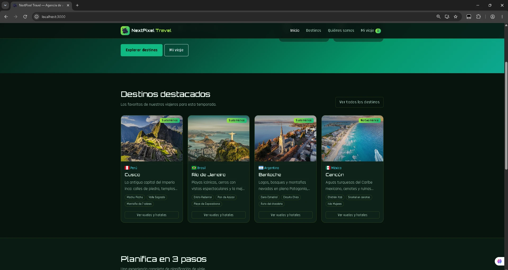
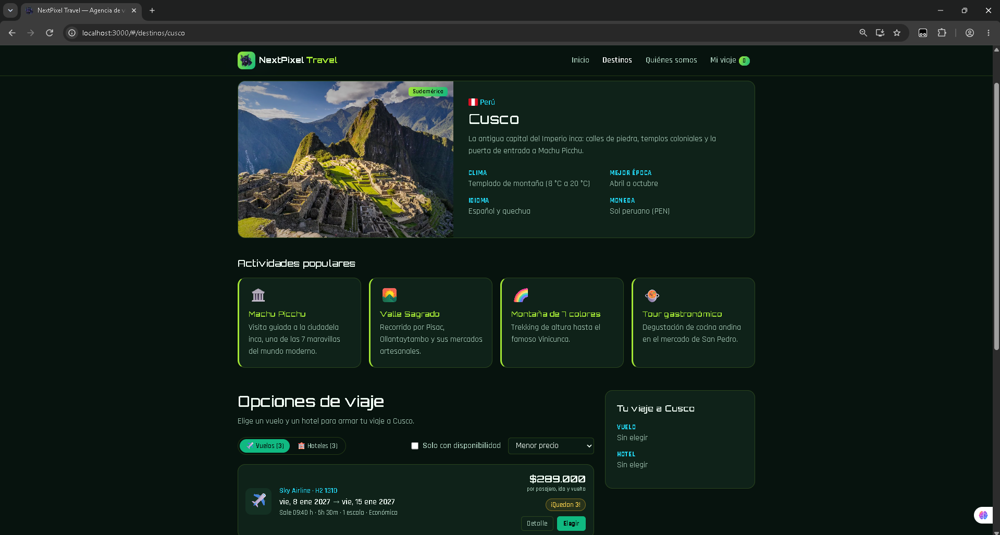
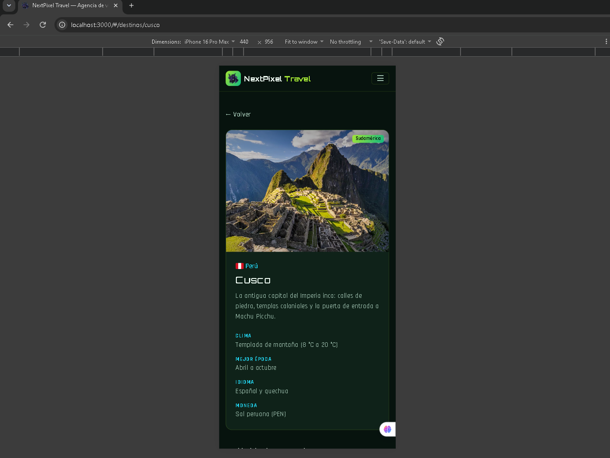
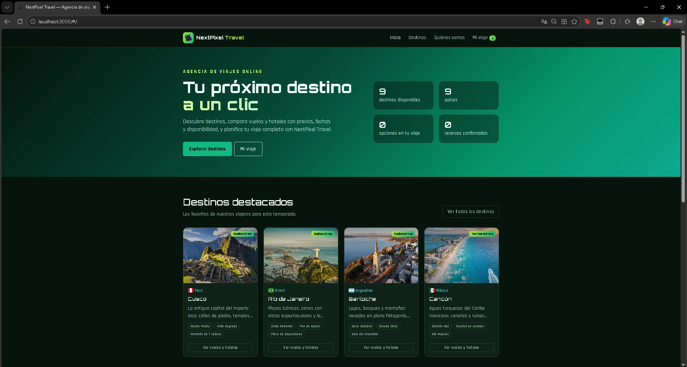
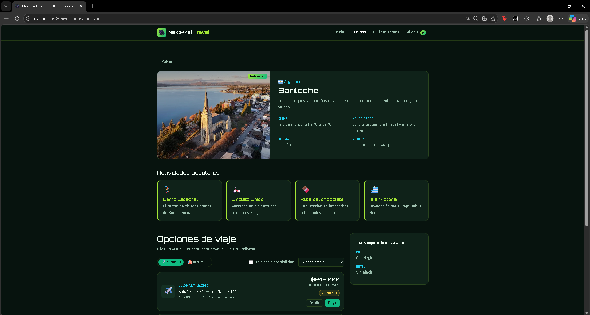
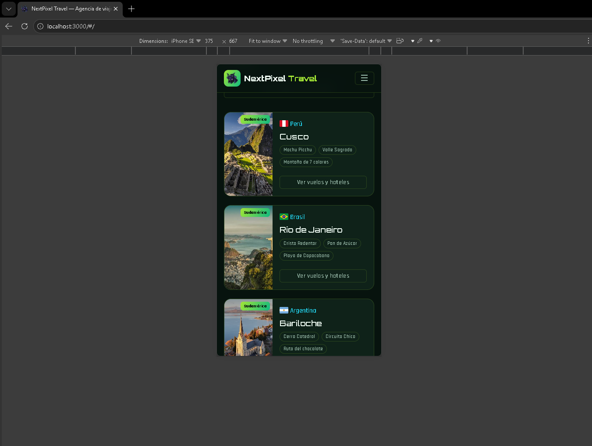
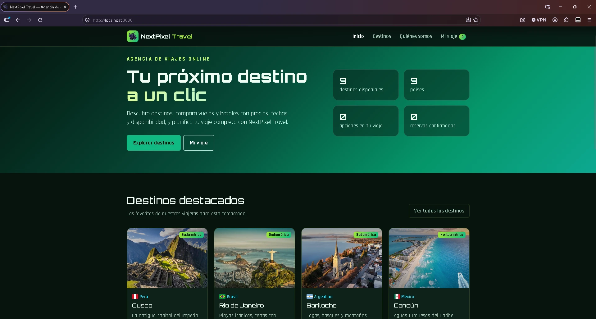
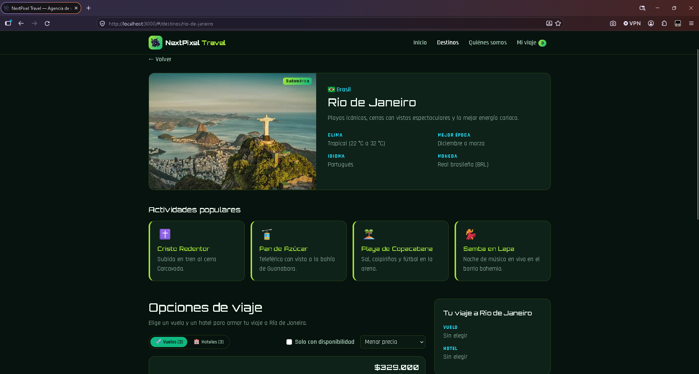
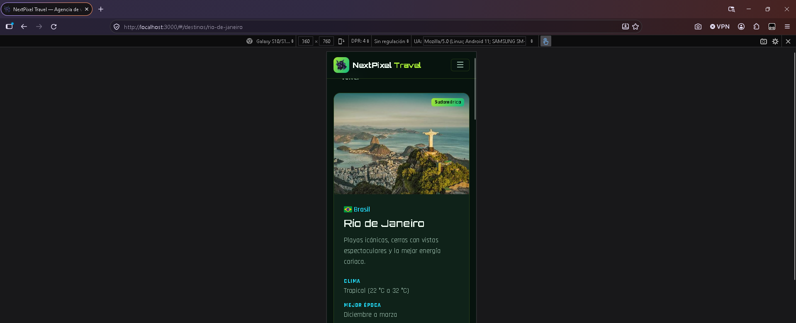

# NextPixel Travel – Agencia de viajes

Sitio web en **React** para una agencia de viajes, **NextPixel Travel**. Se pueden explorar destinos y, al elegir uno, ver los vuelos y hoteles disponibles con sus precios, fechas y disponibilidad para armar el viaje y reservarlo.

Usa la misma identidad visual de NextPixel Market (logo, fuentes Orbitron y Rajdhani, colores verdes y estilo de tarjetas). Proyecto de la asignatura **Desarrollo Frontend II (PFY2202)** de Duoc UC.

- **Autor:** Kevin Aguilar
- **Sitio publicado (gh-pages):** https://kevinaguilarrivas.github.io/viajes-kevin-aguilar-pfy2202/
- **Repositorio:** https://github.com/KevinAguilarRivas/viajes-kevin-aguilar-pfy2202

## Funcionalidades

- **Destinos:** listado con filtro por continente y búsqueda por ciudad, país o actividad. Cada destino muestra su país, clima, idioma, moneda y actividades populares.
- **Vuelos y hoteles:** al entrar a un destino se ven sus vuelos y hoteles en pestañas, con orden por precio o fecha y opción de ver solo los que tienen disponibilidad.
- **Detalle** de cada vuelo y de cada hotel.
- **Mi viaje:** se elige un vuelo y un hotel, se ajustan pasajeros y noches, se calcula el total y se confirma la reserva. Al reservar se descuentan los asientos y habitaciones.
- Indicador de carga, mensajes de error con botón para reintentar y diseño responsive.

## Tecnologías

- React 19 (Create React App)
- React Router DOM 7 (`HashRouter`, rutas anidadas, parámetros y lazy loading)
- MSW 2 (Mock Service Worker) para el backend mock
- Apollo Client + graphql
- Tailwind CSS 3
- Context API con `useState` y `useEffect` (se guarda en `localStorage`)
- gh-pages

## Backend mock

El backend está simulado con MSW en `src/mocks`.

**REST** – destinos:

| Método | Endpoint | Descripción |
|---|---|---|
| GET | `/api/destinos` | Lista de destinos con país, continente y actividades populares |
| GET | `/api/destinos/:id` | Detalle del destino. Si no existe responde 404 |

**GraphQL** – vuelos, hoteles y reservas (`src/mocks/schema.js`):

```graphql
type Query {
  vuelos(destinoId: ID!, soloDisponibles: Boolean): [Vuelo!]!
  hoteles(destinoId: ID!, soloDisponibles: Boolean): [Hotel!]!
  vuelo(id: ID!): Vuelo
  hotel(id: ID!): Hotel
}

type Mutation {
  crearReserva(input: ReservaInput!): Reserva!
}
```

Las consultas que usa el frontend están en `src/graphql/queries.js`. Los datos del mock se guardan en memoria, así que vuelven a su estado inicial al recargar la página. MSW también se activa en producción porque GitHub Pages no tiene backend.

## Rutas

| Ruta | Página |
|---|---|
| `/` | Inicio |
| `/destinos` | Listado de destinos |
| `/destinos/:destinoId` | Destino con sus vuelos y hoteles |
| `/vuelos/:vueloId` | Detalle del vuelo |
| `/hoteles/:hotelId` | Detalle del hotel |
| `/mi-viaje` | Mi viaje y reservas |
| `/quienes-somos` | Quiénes somos |

## Estructura del proyecto

```
src/
├── index.js              # Inicia MSW, Router, Apollo y el contexto
├── App.js
├── index.css             # Tailwind y clases reutilizables
├── routes/AppRoutes.js
├── layouts/MainLayout.js
├── api/destinosApi.js    # Peticiones REST
├── hooks/                # useFetch, useDestinos
├── graphql/              # Cliente Apollo y consultas
├── mocks/                # Handlers REST/GraphQL y esquema
├── data/destinos.js      # Datos del mock
├── context/ViajeContext.js
├── utils/viaje.js        # Cálculo de noches y total
├── components/
└── pages/

public/img/destinos/      # Fotos de cada destino (<id>.jpg)
```

Cada destino muestra la foto `public/img/destinos/<id>.jpg` (por ejemplo `cusco.jpg`). Si la imagen no carga, se muestra un ícono en su lugar.

## Instalación y uso

```bash
npm install
npm start       # http://localhost:3000
npm test
npm run build
```

## Publicación en GitHub Pages

```bash
npm run deploy
```

Después, en GitHub ir a **Settings → Pages** y elegir la rama `gh-pages`.

## Pruebas en navegadores

Se revisó el flujo completo (destinos, filtros, detalle, Mi viaje y reserva) en escritorio y en celular.

| Navegador | Escritorio | Móvil | Observaciones |
|---|---|---|---|
| Google Chrome | ✔ | ✔ | Sin errores. Móvil: iPhone 16 Pro Max (440×956) |
| Microsoft Edge | ✔ | ✔ | Sin errores. Móvil: iPhone SE (375×667) |
| Mozilla Firefox | ✔ | ✔ | Sin errores. Móvil: Galaxy S10 (360×760) |

La vista móvil se probó con el modo dispositivo de las herramientas de desarrollador de cada navegador.

Ajustes hechos durante las pruebas:

- En Windows los emojis de bandera se veían como letras ("PE", "BR"), por eso se cambiaron por imágenes.
- Las portadas de los destinos usaban íconos; se reemplazaron por fotos de cada lugar y se quitó la bandera que aparecía repetida sobre la imagen.

### Capturas

**Google Chrome – Inicio**



**Google Chrome – Destino con vuelos y hoteles**



**Google Chrome – Vista celular (iPhone 16 Pro Max)**



**Microsoft Edge – Inicio**



**Microsoft Edge – Destino con vuelos y hoteles**



**Microsoft Edge – Vista celular (iPhone SE)**



**Mozilla Firefox – Inicio**



**Mozilla Firefox – Destino con vuelos y hoteles**



**Mozilla Firefox – Vista celular (Galaxy S10)**


